# My Simple Umbriel Dotfiles

Hi there! Welcome to my personal Wayland setup.
I use this repository primarily as a backup for my dotfiles and system configurations,
but if you stumble across it, you are more than welcome to borrow snippets or adapt anything here for your own machine!

I built this specifically for **Debian Trixie**.
My goal was to make it as lightweight as possible without any heavy desktop environments or Qt dependencies, while still keeping it comfortable for everyday work.

## Preview
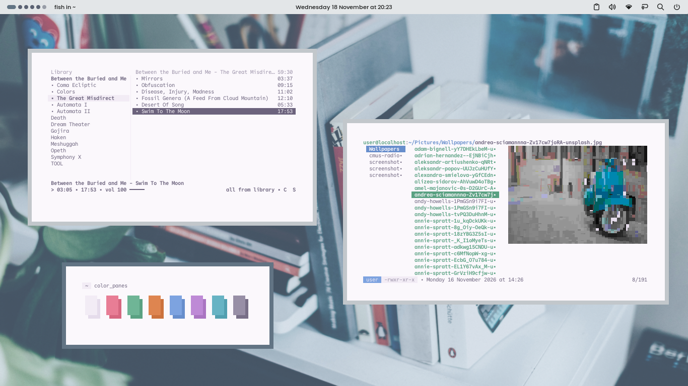
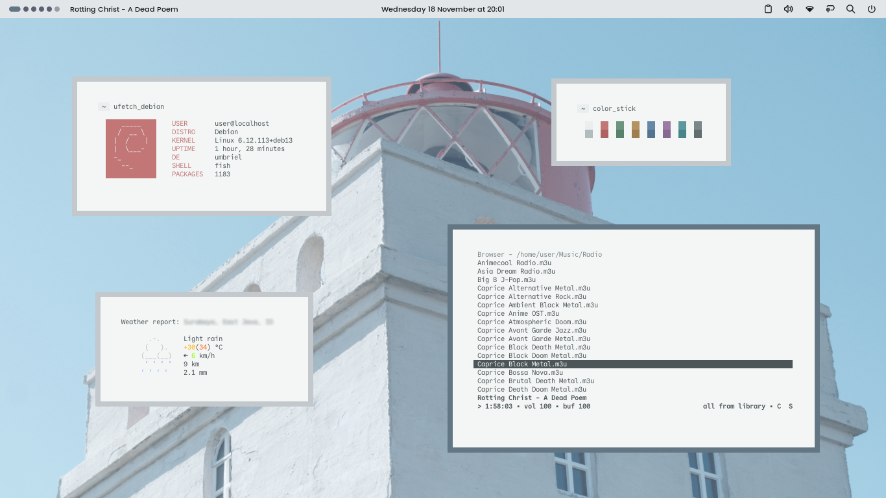
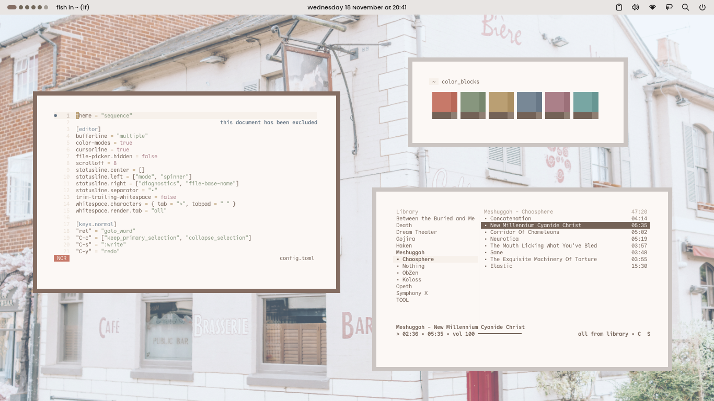
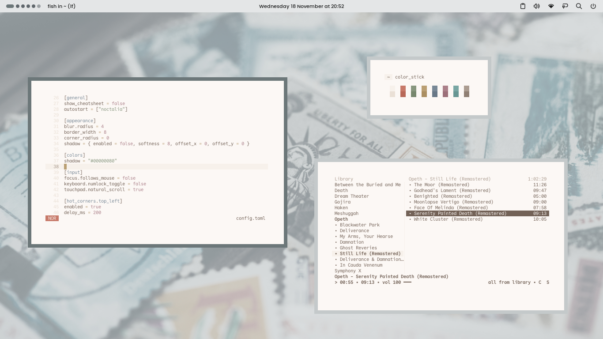
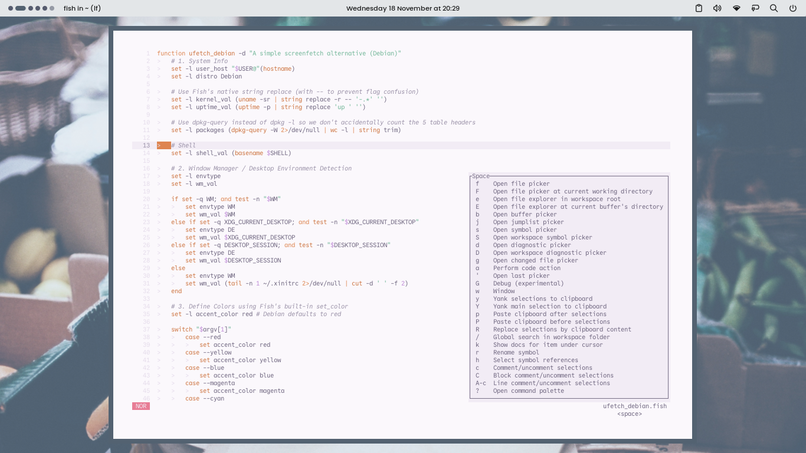
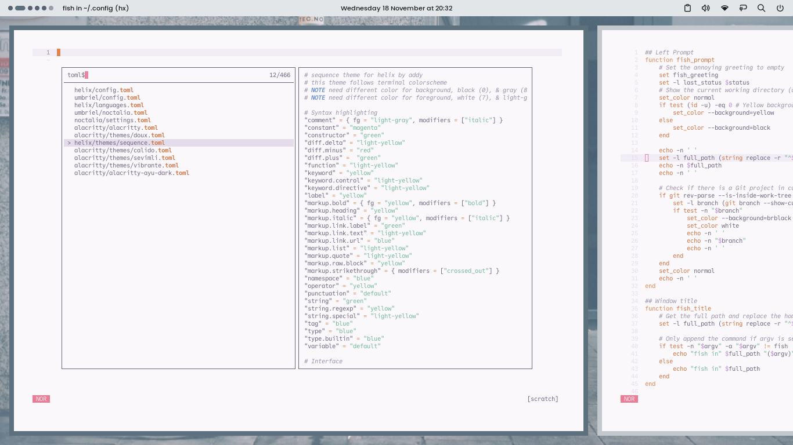
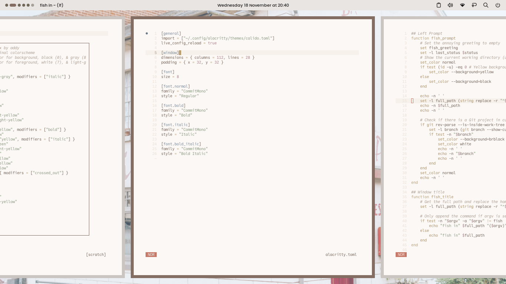
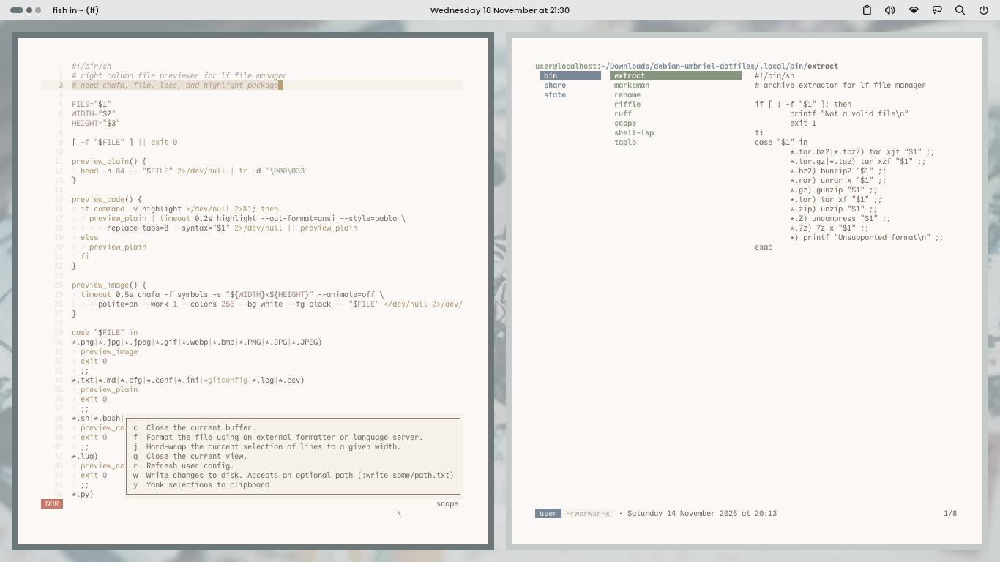
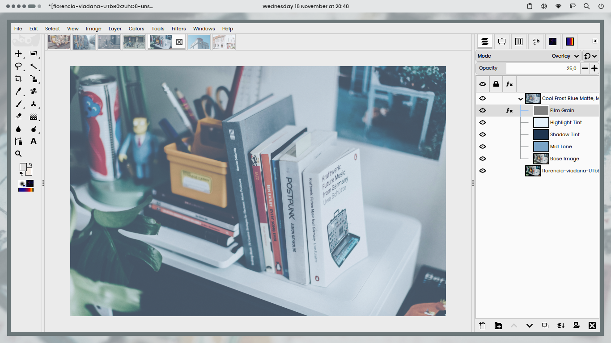
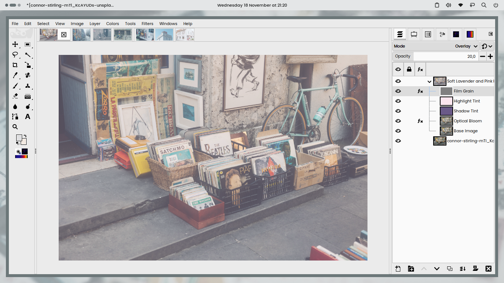
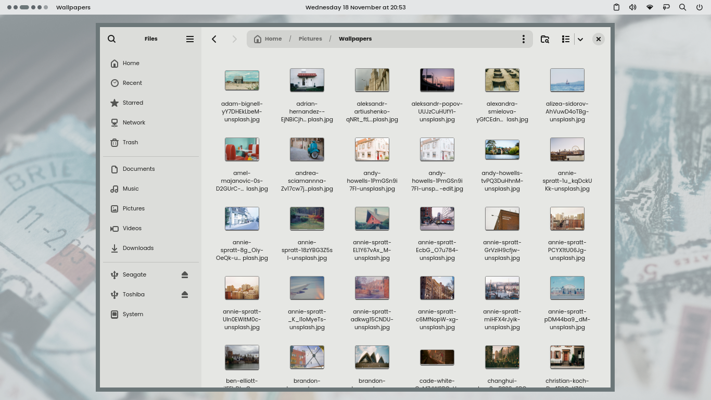
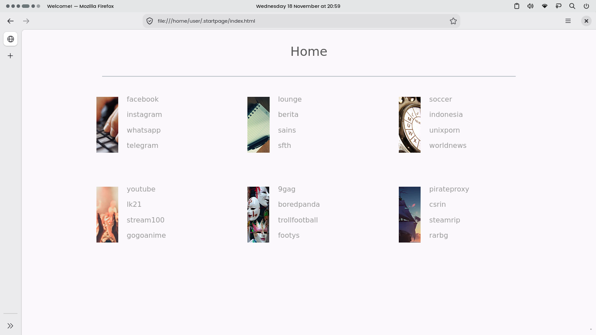
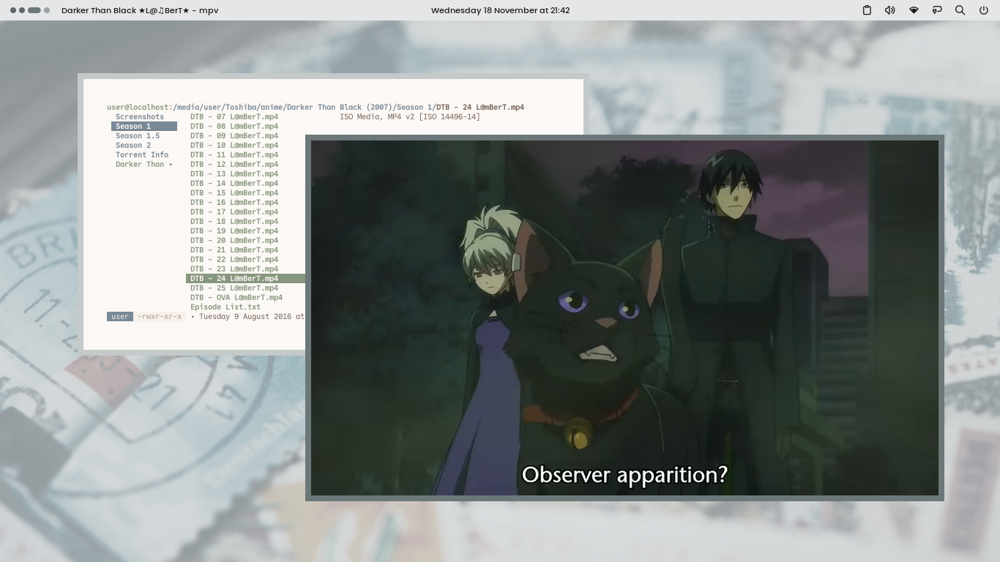

## ✨ Why I Love This Setup

### Scrollable Tiling (Umbriel)
I recently tried scrollable tiling for the first time, and I really like how natural it feels:
* **No Squished Windows:** You can set programs to launch at 75%, 50%, or 100% of the screen width. When you open a new app, it doesn't force your existing windows to shrink or rearrange.
* **Easy on the Eyes:** Whenever a window opens at less than 100% width, it automatically launches in the center of the screen, making it much easier to focus on. Even when I have lots of apps open in a row, I can center my focused window anytime with a quick shortcut (`Mod + X`).
* **Zero Wasted Space:** When I need a program to fill the entire screen without gaps, I can force it edge-to-edge with a single keybind (`Mod + G` or `F11`).
* **Trackpad Friendly:** Umbriel supports three-finger and four-finger trackpad gestures right out of the box by default.

### All-in-One Desktop Shell (Noctalia)
On a traditional X11 window manager setup, you usually have to build a usable desktop by gluing together lots of separate, scattered tools. Noctalia makes things so much simpler. Out of the box, it ships with:
* Top panel & app launcher
* Screenshot tool & clipboard manager
* Notification daemon
* Frontends for NetworkManager, power management, volume, and screen brightness
* A built-in Polkit authentication agent (for password prompts)

Even with all of those features packed in, it still runs super fast and lightweight because it's built in native Rust (not the heavier Qt Quickshell version).

### Current Rough Edges on Wayland
While I'm very happy with this daily setup, I still run into a few Wayland quirks here and there:
* Drag-and-drop between certain apps can be finicky.
* Screen color pickers and `ffmpeg`-based screen recording still give me some trouble.
* GIMP behaves a bit strangely sometimes—rearranging its dockable tabs can occasionally cause it to freeze.

## 🌱 How It Started (The Base Install)

I started this build from the Debian advanced installer to get a completely bare system with **no desktop environment**. During the software selection step (`tasksel`), I unchecked everything—not even "standard system utilities" was ticked.

I did it this way for a few specific reasons:
* I wanted a clean base as a start.
* I needed to set up multiple locales (this is super important for when I install an office suite later, so it handles different document formats, spelling, and numbers properly).
* I wanted `sudo` to be enabled by default (which Debian does automatically if you leave the root password blank during install).
* I needed to set my BIOS time to local time instead of UTC.
* I wanted the `non-free`, `non-free-firmware`, and `backports` repositories enabled right out of the box.

## 🌟 Key Features

Here is what makes up my system, broken down by category:

* **Wayland core, desktop shell, and session management:** Umbriel, Noctalia, and Noctalia Greeter.
* **Hardware acceleration and drivers:** Intel VA-API (for my 3rd and 7th gen Intel chips), Atheros Wi-Fi, and iwlwifi.
* **Utilities and tools:** Alacritty (replaced Kitty because Kitty ran really slow on my laptop), Fish, Git, and Helix (replaced Neovim).
* **Browser and networking:** Firefox ESR and NetworkManager.
* **GUI file manager and archives:** Nautilus, Papers (PDFs), EOG (images), and File Roller.
* **CLI file manager and previews:** `lf`, `chafa` (replaced Kitten image previews), `file`, `less`, and `highlight`.
* **Audio, video, and multimedia:** Pipewire, MPV, Cmus, GIMP, ffmpeg, and GStreamer.

## 📝 My Helix (and Neovim) Setup

I have switched my main text editor from Neovim to **Helix** (`hx`). I still keep my old Neovim configuration saved in this repository just for reference, though!

* **Why Helix from GitHub?** Instead of installing Helix from Debian's `apt` repository, I grab the official `.deb` package directly from the Helix GitHub releases page and install it with `dpkg` because the Debian repository package is missing some important runtime files.
* **Custom `"sequence"` Colorscheme:** I made my own Helix theme called `sequence` that adapts directly to whatever color palette my terminal is using. If you want to use it with your own terminal theme, it expects a few simple contrast rules so highlights and comments remain readable:
  * **For Light Terminal Themes:** `color0` should be slightly darker than `bg` (used for cursor line highlight and popup backgrounds), `color8` should be slightly darker than `color0` (used for text selection), and `color7` should be lighter than `fg` (used for comments).
  * **For Dark Terminal Themes:** `color0` should be slightly brighter than `bg` (cursor line and popups), `color8` should be slightly brighter than `color0` (selection background), and `color7` should be darker than `fg` (comments).

## 🐟 Fish Shell & `~/.local/bin`

* **Default Shell:** I use `/usr/bin/fish` as my default login shell, and my dotfiles include several handy custom Fish functions to speed up daily tasks.
* **Local Binaries & Scripts:** The directory `~/.local/bin` needs to be exported to your `$PATH` (this is already set up inside my Fish config). I store my Helix LSP binaries there, along with helper scripts for the `lf` file manager (such as `scope` for previews and `riffle` for opening files).

## 🛠️ Reinstall & Restore Notes (For Future Me)

In case I ever need to reinstall my system from scratch, here is the full process.

### 1. Add the Noctalia Repository

```bash
wget -q https://pkg.noctalia.dev/deb/nickh-archive-keyring.deb
sudo dpkg -i nickh-archive-keyring.deb
sudo wget -O /etc/apt/sources.list.d/noctalia-trixie.sources https://pkg.noctalia.dev/deb/noctalia-trixie.sources
sudo apt-get update
```

### 2. Install Packages

```bash
# Wayland core, desktop shell, and session management
sudo apt-get install -t trixie-backports umbriel noctalia noctalia-greeter xdg-desktop-portal-umbriel greetd

# Hardware acceleration and drivers
sudo apt-get install intel-media-va-driver-non-free i965-va-driver-shaders mesa-va-drivers mesa-vulkan-drivers libva-wayland2 firmware-atheros firmware-iwlwifi

# Utilities and tools
sudo apt-get install alacritty fish git

# Browser and networking
sudo apt-get install firefox-esr network-manager

# GUI file manager and archives
sudo apt-get install nautilus gvfs-backends gvfs-fuse udisks2 ffmpegthumbnailer file-roller ntfs-3g papers eog zip

# CLI file manager and previews
sudo apt-get install lf chafa file less highlight

# Audio, video, and multimedia
sudo apt-get install pipewire wireplumber pipewire-audio wl-clipboard ffmpeg gstreamer1.0-plugins-good gstreamer1.0-plugins-bad gstreamer1.0-plugins-ugly gstreamer1.0-libav gstreamer1.0-vaapi mpv cmus gimp
```

### 3. Install Helix from GitHub

Download the latest `.deb` file from the [Helix GitHub Releases](https://github.com/helix-editor/helix/releases) page and install it using `dpkg`:

```bash
sudo dpkg -i helix_*.deb
```

### 4. Configure `greetd`, Services, and Default Shell

Tell `greetd` to use Noctalia's greeter by editing `/etc/greetd/config.toml` (with `sudo`):

```toml
[default_session]
command = "noctalia-greeter-session"
```

Then enable the system services and set Fish as your default shell:

```bash
sudo systemctl enable greetd.service
sudo systemctl enable NetworkManager.service
chsh -s /usr/bin/fish
```

### 5. Restore My Dotfiles

To clone this repository and restore the configurations to your home directory:

```bash
git clone https://github.com/addy-dclxvi/debian-umbriel-dotfiles.git
cd debian-umbriel-dotfiles
```

Copy the config folders and local scripts into place (make sure to back up any existing files you want to keep first):

```bash
mkdir -p ~/.config ~/.local/bin
cp -r .config/* ~/.config/
cp -r .local/bin/* ~/.local/bin/
chmod +x ~/.local/bin/*
```

## ⚙️ A Note on My Config Files

If anyone else is reading this and decides to use my config files, please keep a few things in mind!

**1. Locales:**
I use Indonesian locales (`id_ID.utf8`) for things like numbers, paper sizes, and addresses, while keeping the interface language and time format in English (`en_US.utf8`). This mix is crucial for my future office suite. If you aren't in Indonesia, open `umbriel/config.toml` and adjust the `[environment]` section to match your country's locale codes.

**2. Polkit:**
My config enables Noctalia's built-in Polkit agent (`polkit_agent = true` inside the Noctalia config), which is essential because `policykit-1-gnome` is not installed.

**3. Window Launch Sizes:**
In `umbriel/config.toml`, most apps open maximized (100% width) by default, while `Alacritty`, `Nautilus`, `File Roller`, and `EOG` are set to open centered at 75% width.

**4. Future Additions:**
Right now, my fonts, padding, and window gaps are a bit larger than I want, so I will be shrinking them down later. I also haven't installed an office suite or printing support yet, which I plan to add in the future.

## ⌨️ Keybindings

I've mapped most of my shortcuts to the `Mod` (Super/Windows) key.

*A quick note on my layout:* You might notice that my keybinds look a bit unusual, don't strictly follow the standard Umbriel defaults, and leave out some built-in Umbriel features. That is intentional! I use many apps that keep my right hand glued to the mouse (like Firefox, GIMP, and office software), so I designed almost all window operations to be reachable using **only my left hand**. To make switching windows even easier while my right hand is busy, I also enabled the top-left hot corner in Noctalia to quickly trigger the overview screen.

Additionally, in standard Umbriel, `Mod` + `Up/Down` (and with `Shift`) move focus up or down between stacked windows. Because my laptop screen is small, I never split windows vertically, so I repurposed the Up and Down keys to switch and move windows between workspaces instead.

### Basics

| Shortcut | What it does |
| :--- | :--- |
| `Mod` + `A` | Open the App Launcher |
| `Mod` + `Return` | Open Alacritty (Terminal) |
| `Mod` + `E` | Open Nautilus (Files) |
| `Mod` + `W` | Open Firefox |
| `Mod` + `C` or `Alt` + `F4` | Close the current window |
| `Mod` + `Escape` | Log out |
| `Mod` + `Tab` | Toggle the Overview screen |

### Window Focus, Layout & Movement

| Shortcut | What it does |
| :--- | :--- |
| `Mod` + `←` or `h` | Focus on the window to the left |
| `Mod` + `→` or `l` | Focus on the window to the right |
| `Mod` + `WheelUp` / `WheelDown` | Scroll the tiling layout left or right |
| `Alt` + `Tab` / `Alt` + `Shift` + `Tab` | Focus next / previous window |
| `Mod` + `X` | Center the focused window on screen |
| `Mod` + `R` | Cycle window width preset (`75%` / `50%`) |
| `Mod` + `F` | Toggle maximize window (keeps gaps) |
| `Mod` + `G` | Maximize window to screen edges (no gaps) |
| `F11` | Toggle true fullscreen |
| `Mod` + `Space` | Toggle floating mode for the window |
| `Mod` + `Shift` + `Space` | Switch focus between tiled and floating windows |
| `Mod` + `Shift` + `←` or `h` | Move the window column left |
| `Mod` + `Shift` + `→` or `l` | Move the window column right |

### Workspaces

| Shortcut | What it does |
| :--- | :--- |
| `Mod` + `↓` or `j` | Go to the next workspace |
| `Mod` + `↑` or `k` | Go to the previous workspace |
| `Mod` + `Shift` + `↓` or `j` | Move window column to the next workspace |
| `Mod` + `Shift` + `↑` or `k` | Move window column to the previous workspace |
| `Mod` + `1-9` | Jump to workspaces 1 through 9 |
| `Mod` + `Shift` + `1-9` | Send the window to workspaces 1 through 9 |

### Media & Screenshots

| Shortcut | What it does |
| :--- | :--- |
| `Print` | Take a full-screen screenshot |
| `Ctrl` + `Print` | Select a region to screenshot |
| `Media Keys` | Play, Pause, Next, Prev, Volume, and Brightness work natively |
