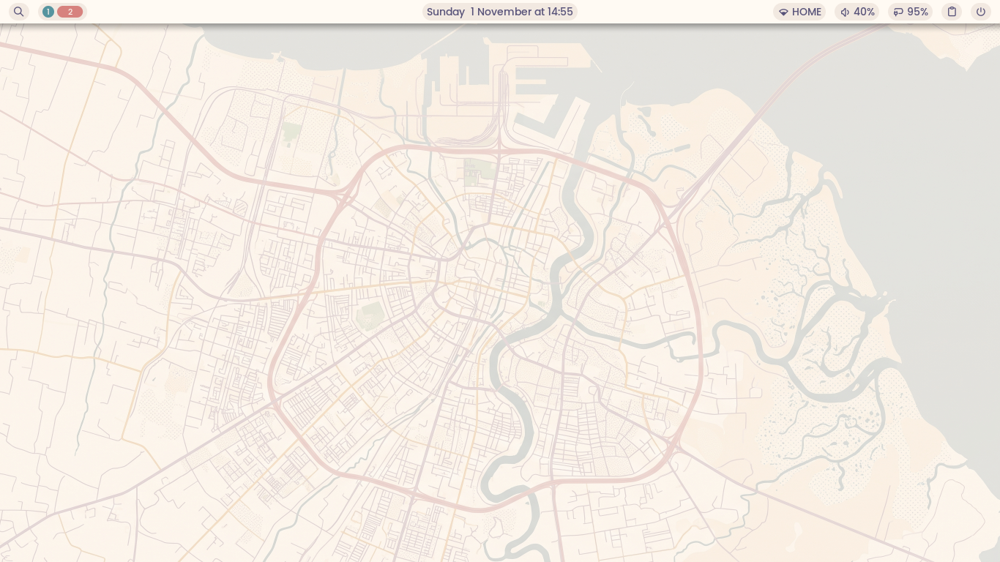
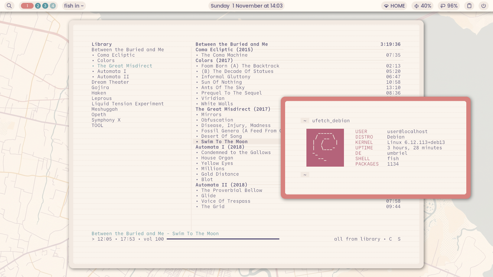
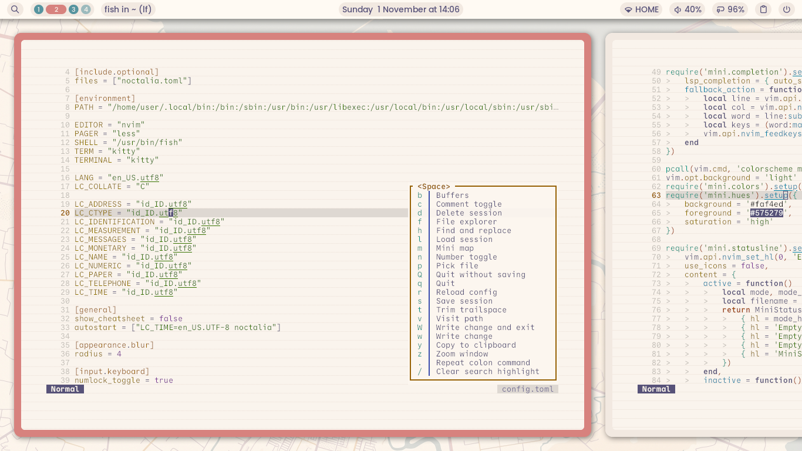
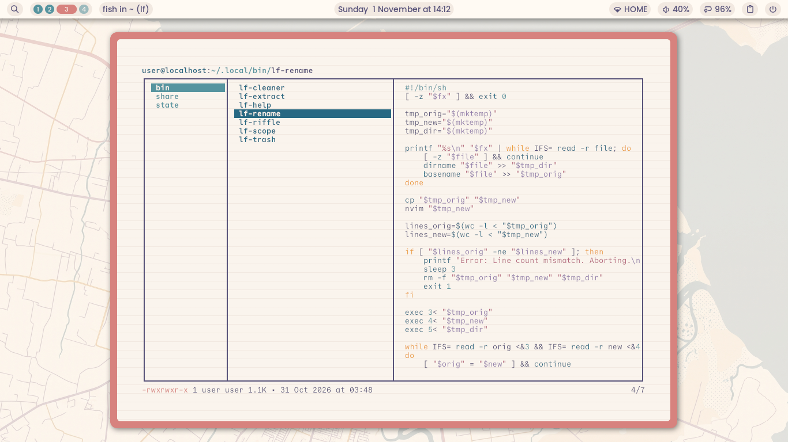
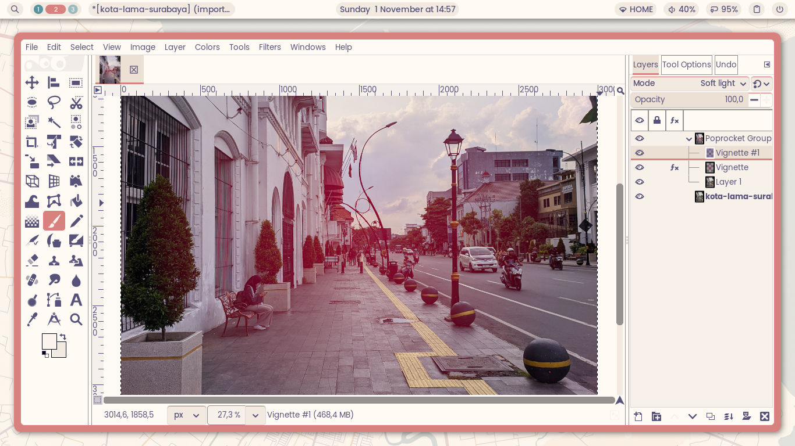
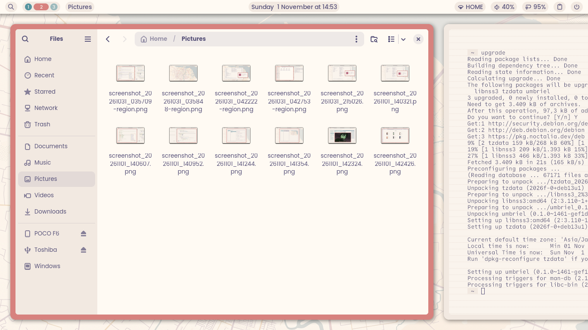
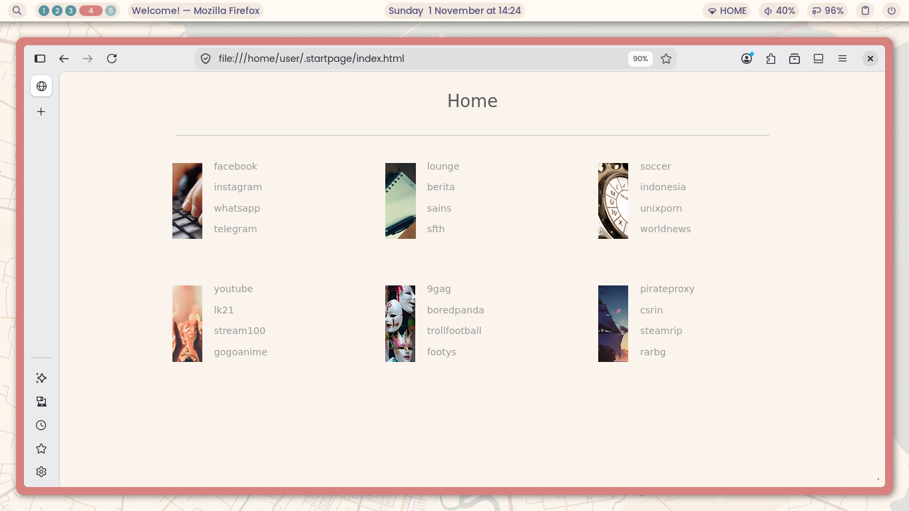
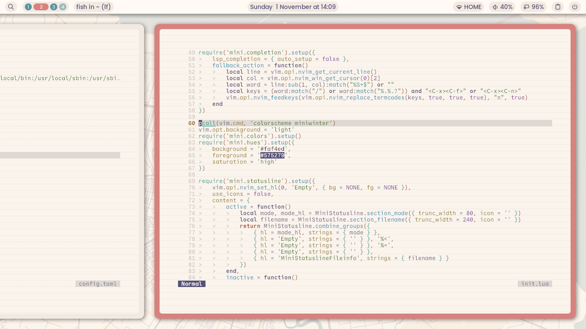
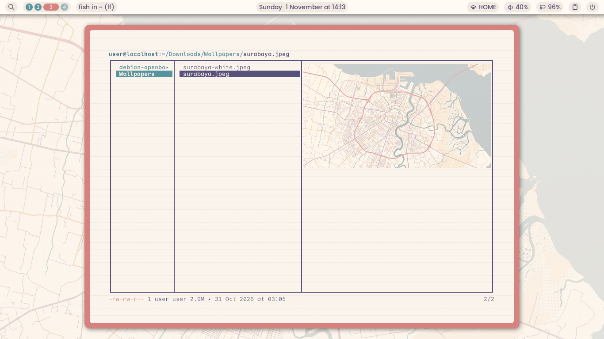
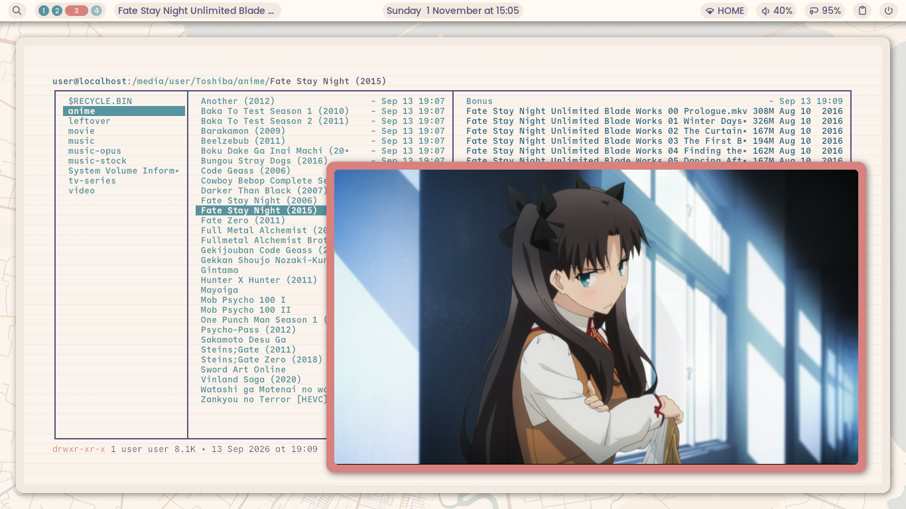

# My Simple Umbriel Dotfiles

Hi there! Welcome to my personal Wayland setup.
I use this repository primarily as a backup for my dotfiles and system configurations,
but if you stumble across it, you are more than welcome to borrow snippets or adapt anything here for your own machine!

I built this specifically for **Debian Trixie**.
My goal was to make it as lightweight as possible without any heavy desktop environments or Qt dependencies but still fully functional.
Because Noctalia handles things like password prompts (Polkit), screenshots, and volume popups natively,
I didn't need to install a bunch of extra background apps to get a working desktop.

## Preview
## Preview











## 🌱 How It Started (The Base Install)

I actually started this build from the Debian advanced installer.
I made sure to install a completely bare system with **no desktop environment**.
In fact, during the software selection step (`tasksel`), I unchecked everything—not even "standard system utilities" was ticked.

I did it this way for a few specific reasons:

* I wanted a clean base as a start.
* I needed to set up multiple locales (this is super important for when I install an office suite later, so it handles different document formats, spelling, and numbers correctly).
* I wanted `sudo` to be enabled by default (which Debian does automatically if you leave the root password blank during install).
* I needed to set my BIOS time to local time instead of UTC.
* I wanted the `non-free`, `non-free-firmware`, and `backports` repositories enabled right out of the box.

## 🌟 Key Features

Here is what makes up my system, broken down by category:

* **Wayland core, desktop shell, and session management:** Umbriel, Noctalia, and Noctalia Greeter.
* **Hardware acceleration and drivers:** Intel VA-API (for my 3rd and 7th gen Intel chips), Atheros Wi-Fi, and iwlwifi.
* **Utilities and tools:** Kitty, Fish, Git, and Neovim.
* **Browser and networking:** Firefox ESR and NetworkManager.
* **GUI file manager and archives:** Nautilus, Papers (PDFs), EOG (images), and File Roller.
* **CLI file manager and previews:** `lf`, file, less, and highlight.
* **Audio, video, and multimedia:** Pipewire, MPV, Cmus, GIMP, ffmpeg, and GStreamer.

## 📝 My Neovim Setup

Since I'm not a software developer, I don't need a heavy Neovim setup with fancy language servers (LSP) or linting engines.
I just need a good, clean text editor.

My entire configuration (`init.lua`) relies on exactly **one** plugin: `mini.nvim`.
It handles everything I need, from file exploring to status lines.

*Note: Because I'm running Debian stable, my Neovim version won't update for a long time.
Just in case `mini.nvim` updates and requires a newer version of Neovim in the future,
I keep a backup copy of the `mini.nvim` plugin folder right here in this dotfiles repository so my setup never breaks!*

## 🛠️ Reinstall Notes (For Future Me)

In case I ever need to reinstall my system from scratch, here is exactly how I set everything up.

### 1. Add the Noctalia Repository

First, the signing key and repository source so Debian knows where to download Umbriel and Noctalia:

```bash
wget -q https://pkg.noctalia.dev/deb/nickh-archive-keyring.deb
sudo dpkg -i nickh-archive-keyring.deb
sudo wget -O /etc/apt/sources.list.d/noctalia-trixie.sources https://pkg.noctalia.dev/deb/noctalia-trixie.sources
sudo apt-get update
```

### 2. Install Packages

```bash
# Wayland core, desktop shell, and session management
sudo apt-get install -t trixie-backports umbriel noctalia noctalia-greeter xdg-desktop-portal-umbriel greetd

# Hardware acceleration and drivers
sudo apt-get install intel-media-va-driver-non-free i965-va-driver-shaders mesa-va-drivers mesa-vulkan-drivers libva-wayland2 firmware-atheros firmware-iwlwifi

# Utilities and tools
sudo apt-get install kitty fish git neovim

# Browser and networking
sudo apt-get install firefox-esr network-manager

# GUI file manager and archives
sudo apt-get install nautilus gvfs-backends gvfs-fuse udisks2 ffmpegthumbnailer file-roller ntfs-3g papers eog zip

# CLI file manager and previews
sudo apt-get install lf file less highlight

# Audio, video, and multimedia
sudo apt-get install pipewire wireplumber pipewire-audio wl-clipboard ffmpeg gstreamer1.0-plugins-good gstreamer1.0-plugins-bad gstreamer1.0-plugins-ugly gstreamer1.0-libav gstreamer1.0-vaapi mpv cmus gimp
```

### 3. Quick Configuration

Tell `greetd` (the login screen) to use Noctalia's greeter. Edit `/etc/greetd/config.toml` (with `sudo`) and change the default command:

```toml
[default_session]
command = "noctalia-greeter-session"
```

Then, enable the services:

```bash
sudo systemctl enable greetd.service
sudo systemctl enable NetworkManager.service
```

## ⚙️ A Note on My Config Files

If anyone else is reading this and decides to use my `config.toml` files, please keep a few things in mind!

**1. Locales:**
I use Indonesian locales (`id_ID.utf8`) for things like numbers and dates, but I keep the main language as English (`en_US.utf8`). As mentioned above, this mix is crucial for my office suite. If you aren't in Indonesia, you'll need to open my `umbriel/config.toml` and change the `[environment]` section to match your own country's locale codes!

**2. Polkit:**
My config automatically enables Noctalia's built-in Polkit agent (`polkit_agent = true` inside the Noctalia config). This is super important because I didn't install `policykit-1-gnome`!

**3. Future Changes:**
Right now, my fonts, padding, and window gaps (24px!) are way too huge. I will definitely be shrinking them down in a future update. I also haven't installed an office suite or printing support yet, but I plan to add those later.

## ⌨️ Keybindings

I've mapped most of my shortcuts to the `Mod` (Super/Windows) key.

*A quick note on my layout:* You might notice that my keybinds look a bit weird, don't really follow the standard Umbriel defaults, and even leave out some default Umbriel features entirely. That is on purpose! I use a lot of apps that require my right hand to stay glued to the mouse (like my web browser, graphic editors, and office software). Because of this, I designed most of the window operations so I can trigger them using **only my left hand** on the keyboard. To make navigating windows even easier while my right hand is busy, I also enabled the top-left hot corner in Noctalia to quickly open the overview screen.

Also, normally in Umbriel, `Mod` + `Up/Down` (and with `Shift`) are used to shift focus up or down between stacked windows. However, because my laptop screen is quite small, I literally *never* split my windows vertically (top and bottom). Since I don't need vertical focus switching, I completely repurposed the up and down arrow keys to switch and move windows between workspaces instead!

### Basics

| Shortcut | What it does | 
| ----- | ----- | 
| `Mod` | Open the App Launcher | 
| `Mod` + `Return` | Open Kitty (Terminal) | 
| `Mod` + `E` | Open Nautilus (Files) | 
| `Mod` + `W` | Open Firefox | 
| `Mod` + `C` or `Alt` + `F4` | Close the current window | 
| `Mod` + `Escape` | Log out | 
| `Mod` + `Tab` | Open the Overview screen | 

### Window Focus & Movement

| Shortcut | What it does | 
| ----- | ----- | 
| `Mod` + `←` or `h` | Focus on the window to the left | 
| `Mod` + `→` or `l` | Focus on the window to the right | 
| `Alt` + `Tab` | Focus next window | 
| `F11` | Fullscreen | 
| `Mod` + `Space` | Float the window | 
| `Mod` + `Shift` + `←` or `h` | Move the window left | 
| `Mod` + `Shift` + `→` or `l` | Move the window right | 
| `Mod` + `Shift` + `1-9` | Send the window to workspaces 1 through 9 | 

### Workspaces

| Shortcut | What it does | 
| ----- | ----- | 
| `Mod` + `↓` or `j` | Go to the next workspace | 
| `Mod` + `↑` or `k` | Go to the previous workspace | 
| `Mod` + `Shift` + `↓` or `j` | Move window to the next workspace | 
| `Mod` + `Shift` + `↑` or `k` | Move window to the previous workspace | 
| `Mod` + `1-9` | Jump to workspaces 1 through 9 | 

### Media & Screenshots

| Shortcut | What it does | 
| ----- | ----- | 
| `Print` | Take a full-screen screenshot | 
| `Ctrl` + `Print` | Select a region to screenshot | 
| `Media Keys` | Play, Pause, Next, Prev, Volume, and Brightness all work natively! | 
